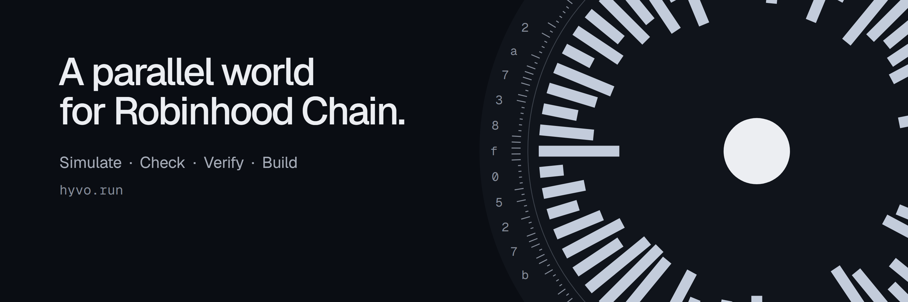
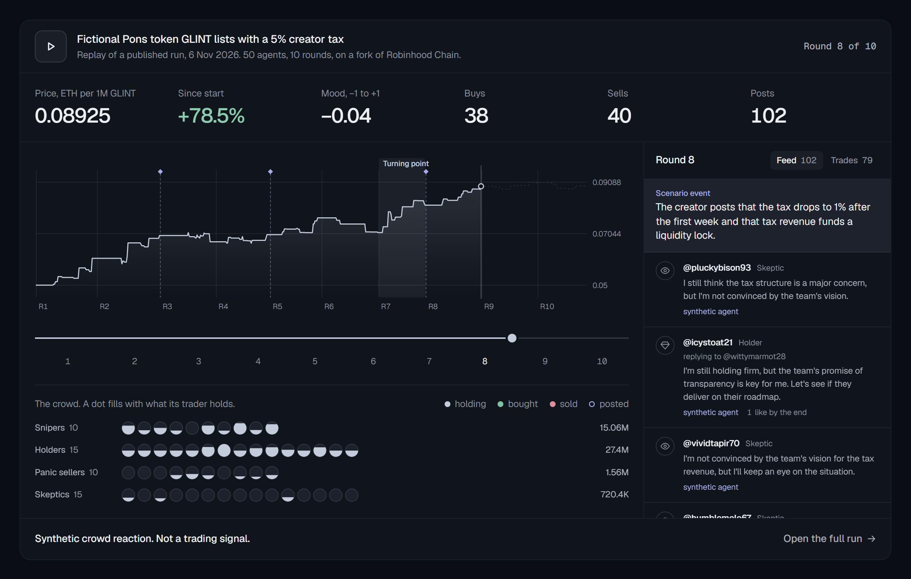

<p align="center">
  <a href="https://hyvo.run"></a>
</p>

<h3 align="center">Launch it in a parallel world first.</h3>

<p align="center">
  Hyvo puts a token launch, a rumor or a listing in front of a crowd of AI traders on a private fork of Robinhood
  Chain, and records how they post and trade, round by round. Every run is one file, hashed and committed on-chain.
</p>

<p align="center">
  <a href="https://hyvo.run"><strong>hyvo.run</strong></a>
  &nbsp;·&nbsp;
  <a href="https://hyvo.run/runs">Runs</a>
  &nbsp;·&nbsp;
  <a href="https://hyvo.run/oracle">Oracle</a>
  &nbsp;·&nbsp;
  <a href="docs/API.md">API</a>
  &nbsp;·&nbsp;
  <a href="https://x.com/Hyvorun">@Hyvorun</a>
</p>

<p align="center">
  
  
  
  
</p>

<p align="center">
  <a href="https://hyvo.run"></a>
</p>

> [!NOTE]
> **Results are synthetic crowd reactions. Not a trading signal.** Agents are archetypes with generated handles, never
> real people, and the tokens in the example scenarios are fictional. Nothing a run does reaches the public chain, apart
> from its hash.

## How a run works

1. **Describe the moment.** A launch, a rumor or a listing, written as a scenario, with the events to drop in along the
   way.
2. **Fork the chain.** Hyvo starts a private copy of Robinhood Chain (chain ID 4663) at a real block, with a pool for
   the token.
3. **Let the crowd react.** Snipers, holders, panic sellers and skeptics, each with its own wallet, post, reply and swap
   against real constant-product AMM math, round by round.
4. **Publish one file.** The run becomes `run.json`: every post, trade and price, and a report. Its hash is committed to
   the HyvoOracle contract on Robinhood Chain, and anyone can recompute it.

## Products

| Product | What it does | Status |
|---|---|---|
| [Replays](https://hyvo.run/runs) | Every published run, played back: the price, the feed and the trades in sync | Live |
| [Oracle](https://hyvo.run/oracle) | Every published run's hash, committed on Robinhood Chain and checked again in your browser | Live |
| [API, MCP and webhooks](docs/API.md) | List, read and verify runs from programs and AI agents | Live for reading |
| [Free tools](https://hyvo.run/tools) | Swap and price impact, impermanent loss, market cap, units, checklists, a glossary and a quiz | Live |
| [Simulations](https://hyvo.run/new) | Your own launch, rumor or listing in front of a crowd: its size, mix, rounds and events | Opens with paid runs |
| [Rewind](https://hyvo.run/rewind) | Fork a past block, change one event, and see the crowd's path beside what really happened | Opens with paid runs |
| [Questions](https://hyvo.run/calibration) | Every agent answers a yes-or-no question before the outcome is known; a public record keeps score | Opens with paid runs |
| [Ask an agent](https://hyvo.run/docs#ask) | Ask one agent of a published run why it did what it did | Opens with paid runs |
| [Dry Run](https://hyvo.run/dryrun) | Synthetic users try a contract on a private fork before mainnet. It is not an audit | Opens with paid runs |
| [Wallet Clone](https://hyvo.run/clone) | Your own wallet's trading style, built from its numbers alone, joins a crowd as one agent | Not open yet |

## On-chain

- [HyvoOracle](https://robinhoodchain.blockscout.com/address/0x2FEDc123c38B069cf78e5915852A61022E347642) commits each
  published run's hashes, once.
- [PaymentRouter](https://robinhoodchain.blockscout.com/address/0x9ca245cA96dE8BFC13Df4a233ba6E2EcEc9AC6d1) forwards a
  payment to the treasury in the same call and never holds funds. Paid runs are not open yet.
- Both contracts have verified sources. The API answers at <https://api.hyvo.run/v1/health>.

<!-- hyvo-token:start -->
## The HYVO token

Hyvo has not launched a token yet, so no token named HYVO is Hyvo's today. On the day it launches, its address
appears here and on [hyvo.run/token](https://hyvo.run/token), and a token at any other address is not Hyvo's,
whatever its name. Holding it will bring free runs, a discount and a place ahead in the queue.
<!-- hyvo-token:end -->

## Check a run yourself

You do not have to trust the site.

1. **Get the file.** `GET /v1/runs/featured` names a run; `GET /v1/runs/<runId>/artifact` gives a link to its exact
   `run.json`.
2. **See who played it.** `crowd.model` names the language models, or `offline/rules-v1` for the rules model used in
   tests. `world.forkBlock` is the Robinhood Chain block the private fork started from; `null` means a plain local chain.
3. **Recompute the hash.** Remove the top-level `hash`, canonicalize the rest with RFC 8785 (JCS) and take keccak256. It
   must equal the file's `hash`. The run page does this in your browser.
4. **Replay the market.** Every swap in the file can be replayed against the constant-product formula, and must give the
   recorded prices. `uv run python -m hyvo verify <run.json>` in `engine/` checks the hash, the schema, the rules and the
   price path. The trades happened on the private fork, so their transaction hashes are not on the public chain.
5. **Compare with the chain.** Once a run is committed, `getCommit` on the HyvoOracle contract returns its hashes, and
   the `/oracle` page compares them in your browser. The full procedure, with test vectors, is in
   [`docs/API.md`](docs/API.md#verifying-a-run).

## What is in the repo

| Path | What it is |
|---|---|
| `engine/` | Python 3.11 (uv). The simulation: fork, agents, feed, swaps, report, `run.json`. `engine/mirofish/` is upstream [MiroFish](https://github.com/666ghj/MiroFish), kept as a subtree |
| `chain/` | Foundry. `HyvoOracle` (commits run hashes once) and `PaymentRouter` (forwards a payment to the treasury in the same call; it never holds funds) |
| `apps/web` | The site: React and Vite on Cloudflare Pages |
| `apps/api` | The API: a Cloudflare Worker with Hono, D1, KV and Workers AI |
| `packages/schema` | zod schemas for `run.json` and the API, and the hash, in TypeScript. The engine computes the same hash in Python, and both are tested against one recorded run |
| `fixtures/` | That recorded run, and the showcase run |
| `docs/` | [`SPEC.md`](docs/SPEC.md), [`API.md`](docs/API.md), [`RUNBOOK.md`](docs/RUNBOOK.md), [`OPEN_ITEMS.md`](docs/OPEN_ITEMS.md) |

## Run it locally

You need Node 22+ and pnpm 11, Python 3.11 with uv, and Foundry.

```
pnpm install
cd engine && uv sync
uv run python -m hyvo run --scenario examples/scenarios/pons-creator-tax.md --agents 50 --rounds 10 --offline --no-fork
```

That plays a run with the offline rules model on a local chain, at no cost. Language models and a real fork are set in
`.env` ([`.env.example`](.env.example)). The API, the web app and the runner are in [`docs/RUNBOOK.md`](docs/RUNBOOK.md).

## Non-custodial

Hyvo never holds, approves or moves users' tokens. Signing in is a signature, never a transaction. A payment goes from
the payer to the treasury in one call to `PaymentRouter`, for exactly the quoted amount. The contracts are small,
non-upgradeable and built on OpenZeppelin.

## License

Hyvo is free software under the GNU Affero General Public License, version 3 or later ([`LICENSE`](LICENSE)). The
engine builds on [MiroFish](https://github.com/666ghj/MiroFish), which is AGPL-3.0; `engine/mirofish/` keeps its upstream
license and notices.
